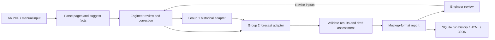

# Architecture

The workflow is explicit application code. No autonomous agent framework is required.

## Modules

- `models`: versioned boundary records with JSON Schema export.
- `intake`: PDF parsing, labeled-field suggestions, evidence acceptance, correction provenance.
- `adapters`: Group 1/2 protocols, JSON adapters, unavailable adapters, template assessment writer.
- `demo`: static synthetic fixtures with input fingerprints. Fixture values are not estimating formulas.
- `workflow` and `validation`: component coordination, issues, reference and numerical checks, revision comparisons.
- `storage`: SQLite runs and local document bytes. Original run results persist; only explicit review metadata changes in place.
- `reporting` and `templates`: a shared report renderer used by the UI and CLI.
- `app.py`: local Streamlit screens; no engineering calculations in UI callbacks.

## Evidence and corrections

A parsed document is identified by SHA-256 and retains page text. Extraction suggestions carry the document ID, page, original wording, normalized value, and status. They are not automatically applied. Accepting a suggestion confirms it. Manual changes supersede previous candidates and add a user-origin record with a change reason. Blank/TBD values remain missing.

Source documents are untrusted data; their text cannot call tools or change workflow instructions. HTML rendering escapes input. The prototype has no model or external-service execution path.

## Runtime behavior

Generate makes a new immutable result snapshot, with a parent run ID when revising. Component outputs must identify the exact project input fingerprint. UI refreshes recover saved runs from SQLite; widget state alone is not persistence. Group response validation failures produce visible errors and unavailable outputs. Matching fixtures only run in explicit demo mode; real AA documents cannot be mixed with demo outputs.

Missing project inputs produce questions with an owner and affected forecast output. Supported outputs can still appear in a partial draft. Conflicting inputs and validation errors block marking the run reviewed. Review does not authorize publication.

## Future provider integration

Implement `FactExtractor.extract(document)` and `AssessmentWriter.draft(project, history, forecast)` with a chosen model provider behind the existing boundaries. Preserve source IDs and typed outputs; add provider/version metadata and enforce citations. Do not give a model responsibility for arithmetic or allow uploaded instructions to control tool use. No credential or provider setup is currently required.
